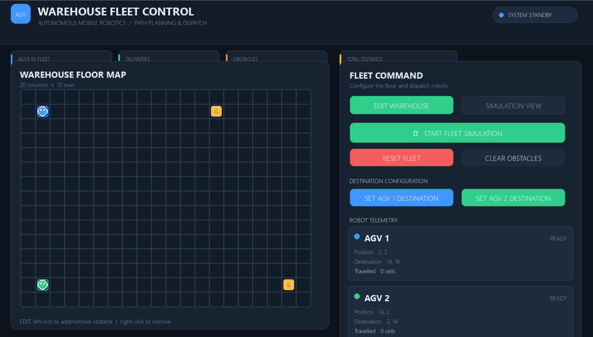
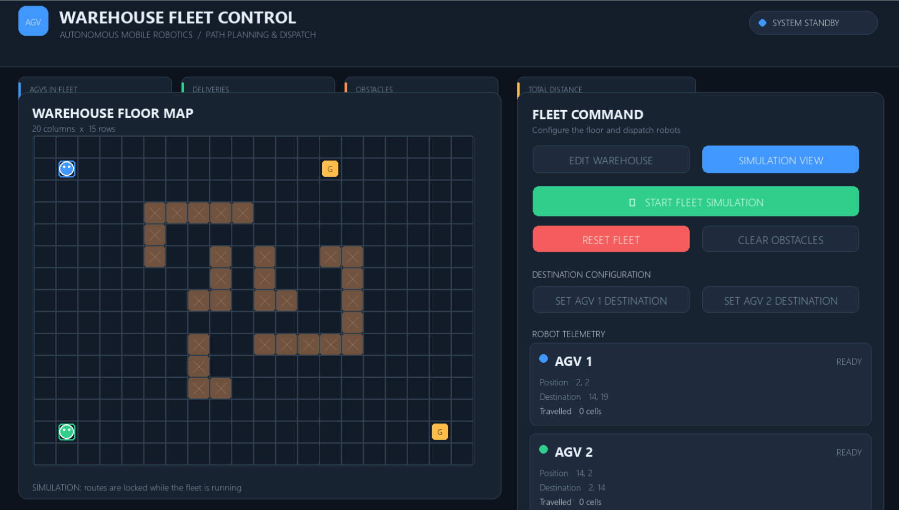
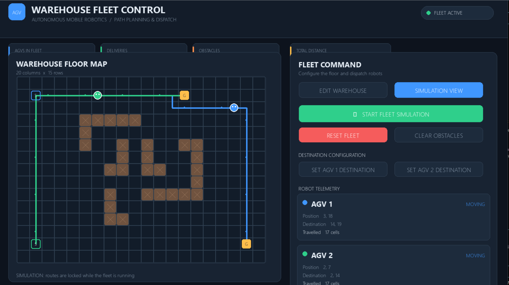

# Warehouse AGV Fleet Simulator

A Python-based warehouse automation simulator that demonstrates multi-AGV navigation, path planning, obstacle avoidance, and fleet management using Pygame.

## Dashboard Preview

## Simulation Screenshots

### Warehouse Map

### AGV Fleet in Action

## Features

- Interactive warehouse grid (20 columns × 15 rows).
- Two Autonomous Guided Vehicles (AGVs).
- A* pathfinding algorithm.
- Collision avoidance between AGVs.
- Dynamic obstacle placement and removal.
- Individual destination configuration.
- Real-time AGV movement and telemetry.
- Fleet simulation and reset controls.
- Interactive warehouse editing and simulation modes.

## Technologies Used

- Python 3.13
- Pygame 2.6.1
- A* Search Algorithm
- Time-Expanded Pathfinding
- Git and GitHub

## Installation

1. Clone the repository:

   `git clone https://github.com/YOUR-USERNAME/Warehouse-AGV-Fleet-Simulator.git`

2. Navigate to the project folder:

   `cd Warehouse-AGV-Fleet-Simulator`

3. Install dependencies:

   `pip install -r requirements.txt`

4. Run the simulator:

   `python main.py`

## Controls

- Left-click: Add or toggle obstacles.
- Right-click: Remove obstacles.
- Edit Warehouse: Configure the warehouse.
- Simulation View: View the fleet simulation.
- Start Fleet Simulation: Start AGV movement.
- Reset Fleet: Reset robot positions.
- Clear Obstacles: Remove all obstacles.

## Project Objective

To simulate an intelligent warehouse environment where multiple AGVs navigate between locations while avoiding obstacles and preventing inter-robot collisions.

## Author

Anuja Rameshwar Katkade
